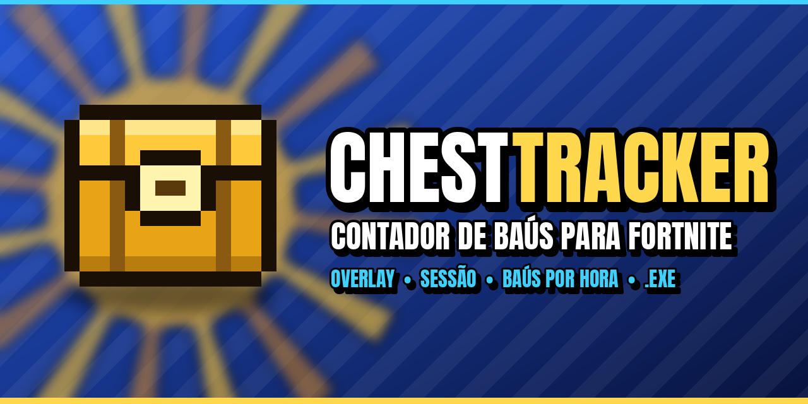
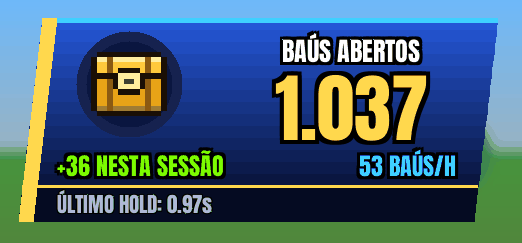
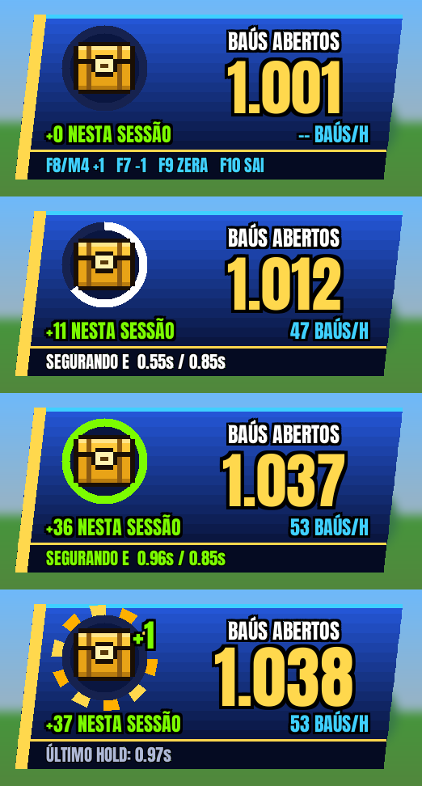

<p align="center">
  
</p>

<p align="center">
  <a href="https://github.com/gotolouco/ChestTracker/releases/latest"></a>
  <a href="https://github.com/gotolouco/ChestTracker/releases"></a>
  
  
</p>

<p align="center">
  <b>Overlay que conta os baús que você abre no Fortnite.</b><br>
  Segure <b>E</b> até o baú abrir e ele soma sozinho, num painel no estilo do HUD do jogo.
</p>

<p align="center">
  <a href="https://github.com/gotolouco/ChestTracker/releases/latest/download/ChestTracker.exe"><b>⬇ Baixar ChestTracker.exe</b></a>
</p>

<p align="center">
  
</p>

## Recursos

- **Contagem automática:** segurar E pelo tempo de abrir um baú soma +1. Toque rápido (pegar item) e hold longo (reviver) não contam.
- **Anel de interação:** enche enquanto você segura E e fica verde quando o tempo já vai contar.
- **Sessão e ritmo:** mostra quantos baús você abriu desde que abriu o programa e quantos por hora.
- **Atalhos manuais:** F8 ou Mouse 4 somam, F7 desconta, F9 zera.
- **Não atrapalha o jogo:** o mouse passa através do painel, e a contagem fica salva em `baus.json`.

## Download

Baixe o **`ChestTracker.exe`** na [última versão](https://github.com/gotolouco/ChestTracker/releases/latest). Não precisa instalar Python.

1. Coloque o `.exe` numa pasta só dele. A contagem é salva em `baus.json` nessa pasta.
2. Deixe o Fortnite em **Tela cheia em janela**. Na tela cheia normal o overlay não aparece.
3. Abra o `ChestTracker.exe`. Para fechar, aperte **F10**.

> O Windows pode mostrar "O Windows protegeu o computador", porque o `.exe` não tem assinatura digital paga. Clique em **Mais informações → Executar assim mesmo**.

### Rodando pelo código

1. Instale o [Python](https://www.python.org/downloads/) marcando **Add to PATH**.
2. Dê dois cliques em `iniciar.bat`. Ele instala o `pynput` e abre o overlay.

## Atalhos

| Tecla | Ação |
|---|---|
| Segurar E | +1 baú, se o tempo estiver entre `--min` e `--max` |
| F8 ou Mouse 4 | +1 baú |
| F7 | −1 baú |
| F9 | zera o total |
| F10 | fecha |

## Opções

Funcionam no `.exe` e no script:

```
ChestTracker.exe --min 0.85 --max 3.0 --escala 1.5 --x 30 --y 30
```

| Opção | Padrão | O que faz |
|---|---|---|
| `--min` | 0.85 | segundos mínimos segurando E para contar |
| `--max` | 3.0 | acima disso não conta (ex.: reviver alguém) |
| `--tecla` | e | tecla de interação |
| `--escala` | 1.0 | tamanho do painel (1.5 em telas 2K/4K) |
| `--x`, `--y` | 30 | posição do painel na tela |
| `--arquivo` | baus.json | onde salvar a contagem |
| `--zerar` | — | começa do 0 |
| `--debug` | — | log detalhado |
| `--autoteste` | — | roda os testes da contagem e sai |

O rodapé mostra quanto tempo você segurou E no último hold. Use esse valor para ajustar o `--min`.

<p align="center"></p>

## Limites

- Caixas de munição também abrem segurando E e contam como baú. Corrija com F7.
- O contador só lê o teclado e o mouse e desenha uma janela. Ele não mexe no jogo.

## Nova versão

Mude o número no arquivo `VERSION` (ex.: `1.1.0`) e envie para a `main`. O GitHub testa, gera o `ChestTracker.exe` e publica a release `v1.1.0` sozinho.

---

<sub>ChestTracker é um projeto de fã e não tem ligação com a Epic Games. Fortnite é marca registrada da Epic Games, Inc.</sub>
