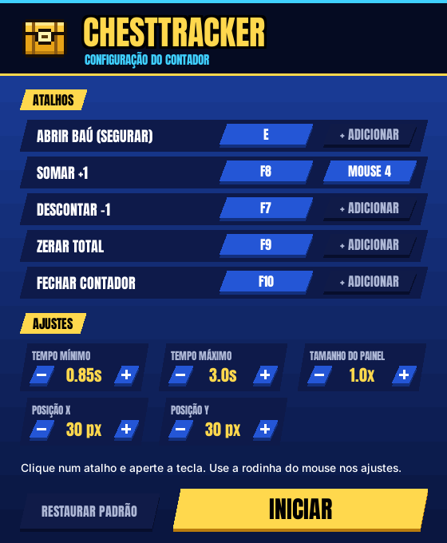

  

  
  
  
  

  <b>Overlay que conta os baús que você abre no Fortnite.</b> 
  Segure <b>E</b> até o baú abrir e ele soma sozinho, num painel no estilo do HUD do jogo.

  <a href="https://github.com/gotolouco/ChestTracker/releases/latest/download/ChestTracker.exe"><b>⬇ Baixar ChestTracker.exe</b></a>

  

## Recursos

- **Contagem automática:** segurar E pelo tempo de abrir um baú soma +1. Toque rápido (pegar item) e hold longo (reviver) não contam.
- **Anel de interação:** enche enquanto você segura E e fica verde quando o tempo já vai contar.
- **Sessão e ritmo:** mostra quantos baús você abriu desde que abriu o programa e quantos por hora.
- **Atalhos do seu jeito:** escolha qualquer tecla ou botão do mouse (meio, 4 e 5) para cada ação, na janela que abre antes do painel.
- **Não atrapalha o jogo:** o mouse passa através do painel, e a contagem fica salva em `baus.json`.

## Download

Baixe o **`ChestTracker.exe`** na [última versão](https://github.com/gotolouco/ChestTracker/releases/latest). Não precisa instalar Python.

1. Coloque o `.exe` numa pasta só dele. A contagem é salva em `baus.json` nessa pasta.
2. Deixe o Fortnite em **Tela cheia em janela**. Na tela cheia normal o overlay não aparece.
3. Abra o `ChestTracker.exe`, confira os atalhos e clique em **INICIAR**. Para fechar o painel, use o atalho de fechar (padrão **F10**).

> O Windows pode mostrar "O Windows protegeu o computador", porque o `.exe` não tem assinatura digital paga. Clique em **Mais informações → Executar assim mesmo**.

### Rodando pelo código

1. Instale o [Python](https://www.python.org/downloads/) marcando **Add to PATH**.
2. Dê dois cliques em `iniciar.bat`. Ele instala o `pynput` e abre o overlay.

## Configuração

Antes do painel abre uma janela para ajustar tudo. As escolhas ficam salvas em `config.json`, ao lado do `.exe`, e voltam preenchidas na próxima vez.

- **Atalhos:** clique num botão e aperte a tecla ou o botão do mouse. Cada ação aceita até 2 atalhos. **Esc** cancela e **Backspace** deixa o espaço vazio. Se o atalho já estava em outra ação, ele sai de lá.
- **Tempo mínimo e máximo:** segurar a tecla de abrir baú por um tempo entre os dois conta +1. O padrão é de 0,85 s a 3 s.
- **Tamanho e posição do painel:** use 1.5 ou mais em telas 2K/4K.
- **Mudar os números:** clique em **+** e **−** (segure para ir mais rápido) ou use a rodinha do mouse em cima do ajuste.

| Ação | Atalho padrão |
|---|---|
| Abrir baú (segurar) | E |
| Somar +1 | F8 ou Mouse 4 |
| Descontar −1 | F7 |
| Zerar total | F9 |
| Fechar contador | F10 |

O rodapé do painel mostra quanto tempo você segurou no último hold. Use esse valor para ajustar o tempo mínimo.

### Opções de linha de comando

| Opção | O que faz |
|---|---|
| `--direto` | pula a janela e abre o painel com o `config.json` salvo |
| `--arquivo` | onde salvar a contagem (padrão `baus.json`) |
| `--config` | onde salvar os atalhos e ajustes (padrão `config.json`) |
| `--zerar` | começa a contagem do 0 |
| `--debug` | log detalhado |
| `--autoteste` | roda os testes e sai |

## Limites

- Caixas de munição também abrem segurando E e contam como baú. Corrija com o atalho de descontar (padrão F7).
- O contador só lê o teclado e o mouse e desenha uma janela. Ele não mexe no jogo.

## Nova versão

Mude o número no arquivo `VERSION` (ex.: `1.1.0`) e envie para a `main`. O GitHub testa, gera o `ChestTracker.exe` e publica a release `v1.1.0` sozinho.

---

ChestTracker é um projeto de fã e não tem ligação com a Epic Games. Fortnite é marca registrada da Epic Games, Inc.
